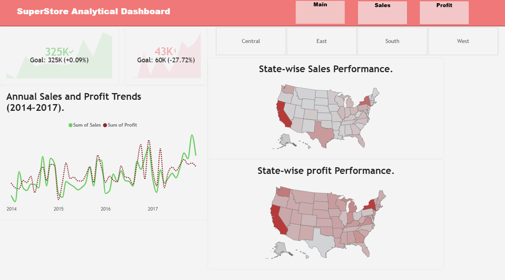
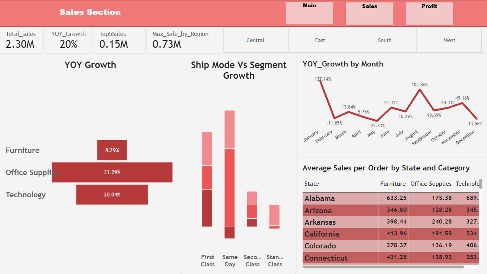
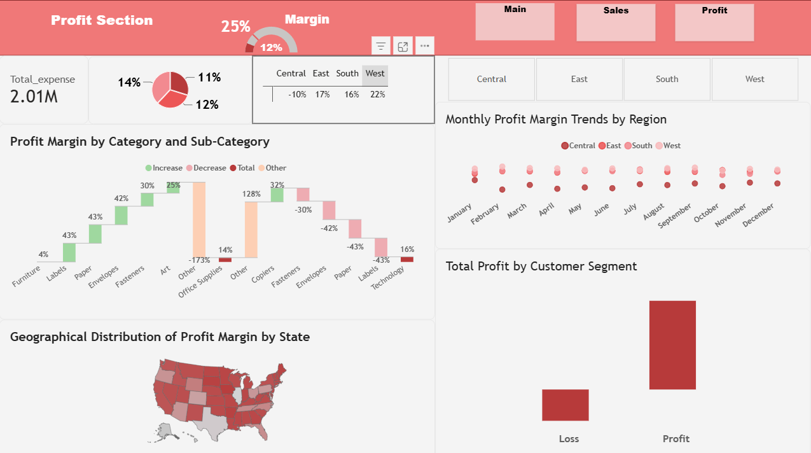

# Superstore Sales & Profit Analysis Dashboard

## Project Overview
This project presents an interactive Power BI dashboard designed to analyse Superstore business performance, focusing on sales, profit, expenses and regional performance.

## Tools & Technologies
- Microsoft Power BI
- DAX (Data Analysis Expressions)
- Data Visualisation
- Data Analysis

## Dashboard Pages

### 1. Main Dashboard
Provides an overview of overall sales and profit performance.

### 2. Sales Dashboard
Key metrics and analysis:
- Total Sales
- Year-over-Year (YoY) Growth
- Top 5 Sales
- Maximum Sales by Region
- Average Sales per Order by State and Category
- Sales trends over time
- Shipping Mode and Customer Segment analysis

### 3. Profit Dashboard
Includes:
- Total Expense KPI
- Profit Margin by Category and Sub-Category
- State-wise Profit Performance
- Monthly Profit Margin Trends by Region
- Total Profit by Customer Segment
- Annual Sales and Profit Trends (2014–2017)

## Key Features
- Three interactive dashboard pages
- Custom DAX measures
- KPI analysis
- Geographical data visualisation
- Time-based trend analysis
- Business performance reporting

## Dashboard Preview

### Main Dashboard

### Sales Dashboard

### Profit Dashboard

## Author
Lubhansh Shedha
